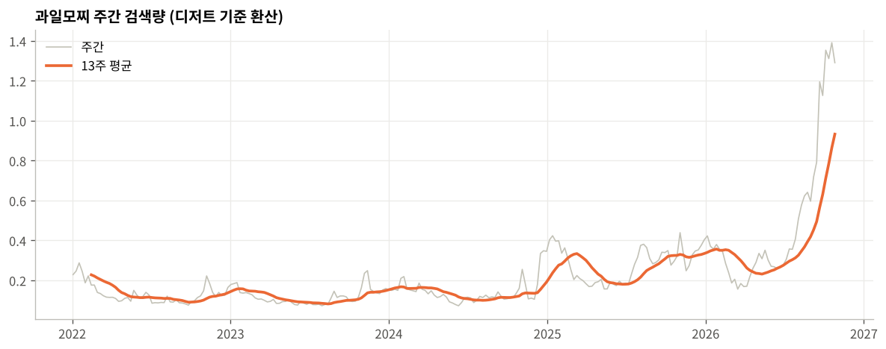

# 디저트 유행은 얼마나 갈까?
### 네이버 검색량으로 본 디저트 수명주기와 출시 타이밍

> 새로 뜨는 디저트, 지금 출시해도 늦지 않을까?
> 정규 메뉴로 갈까, 기간 한정으로 갈까?

상품기획에서 가장 자주 마주치는 이 질문을 **10년치 검색 데이터**로 답해 본 프로젝트입니다.

| 항목 | 내용 |
|---|---|
| 데이터 | 네이버 데이터랩 검색어트렌드 (2016.01 \~ 2026.10, 주간) · 행정안전부 지방행정 인허가 데이터 (전국 휴게음식점·제과점 72만 건) |
| 대상 | 디저트 키워드 21개 + 기준 키워드 2개 |
| 도구 | Python (pandas, matplotlib), Jupyter Notebook |
| 분석 노트북 | [dessert_lifecycle.ipynb](dessert_lifecycle.ipynb) |
| 진단 페이지 | [hyeran712.github.io/dessert-lifecycle](https://hyeran712.github.io/dessert-lifecycle/) |

---

## 핵심 발견

### ① 급하게 뜬 디저트는 급하게 진다


| 구분 | 키워드 수 | 반감기 (중앙값) | 현재 수준 (피크 대비) |
|---|---|---|---|
| 20주 안에 피크 도달 | 9개 | **10주** | 7% |
| 40주 이상 걸려 피크 도달 | 6개 | **48주** | 33% |

흑당, 탕후루, 두바이 초콜릿, 달고나는 몇 달 만에 피크를 찍고 그만큼 빨리 사라졌습니다.
소금빵, 베이글, 흑임자는 몇 년에 걸쳐 천천히 오르고, 피크가 지나도 검색량의 3분의 1 이상을 유지합니다.


상승 기간과 현재 수준의 순위 상관계수는 **0.68**입니다. 천천히 뜬 디저트일수록 오래 남았습니다.

### ② 시즌형 디저트는 출시 달이 정해져 있다


쑥은 4월, 딸기모찌는 12\~2월, 찹쌀떡은 11월(수능 시즌)에 검색이 몰립니다.
이런 메뉴는 **피크 1\~2개월 전에 출시 일정을 고정**하는 것이 유리합니다.

### ④ 검색 피크를 보고 따라가면 늦다 (매장 데이터 검증)


검색량은 관심도일 뿐이라, 행정안전부 인허가 데이터로 **실제 가게가 언제 생기고 닫았는지** 확인했습니다. 상호에 키워드가 들어간 가게만 셌고, 90일 안에 닫은 곳은 팝업 매장으로 분리했습니다.

| 디저트 | 검색 피크 | 매장 수 최고점 | 최고 → 현재 | 1년 내 폐업 (피크 전 / 후 개업) | 팝업 비율 |
|---|---|---|---|---|---|
| 탕후루 | 2023.08 | 2024.01 | 1,123 → 139곳 | 10.8% / **28.6%** | 7% |
| 크로플 | 2020.09 | 2023.02 | 312 → 76곳 | 0% / 20.7% | 25% |
| 마카롱 | 2018.05 | 2020.07 | 519 → 144곳 | 6.4% / 8.8% | 19% |
| 베이글 | 2023.03 | 2026.08 | 366 → 365곳 | 12.6% / 11.9% | 26% |
| 모찌 | 2026.10 | 진행 중 | 152곳 | – | **57%** |

- 탕후루는 검색 피크 이후 개업한 가게의 1년 내 폐업률이 피크 전 개업보다 **약 2.6배** 높았습니다.
- 크로플·마카롱은 검색이 꺼지고 2년쯤 지나서야 매장 수가 최고점에 도달했습니다. 늦게 들어온 공급이 많았다는 뜻입니다.
- 베이글은 검색 피크 이후에도 매장이 계속 늘어, 매장 데이터에서도 정착형으로 나타났습니다.
- 모찌는 인허가의 절반 이상이 백화점·쇼핑몰 팝업으로, 아직 브랜드들이 반응을 시험하는 단계입니다.

### ⑤ 지금 뜨는 디저트: 과일모찌



과일모찌는 2026년 10월 현재 **역대 최고 검색량**을 기록 중이며, 최근 13주 검색량이 전년 같은 시기보다 **+187%** 늘었습니다.

| 피크 대비 검색량 | 유행형 (중앙값) | 정착형 (중앙값) | 과일모찌 |
|---|---|---|---|
| 피크 52주 전 | 1% | 48% | 27% |
| 피크 13주 전 | 16% | 70% | 38% |

과일모찌는 바닥에서 갑자기 튀어 오른 유행형과 달리 **2025년부터 이미 기반이 있었고**, 2026년 7월부터 급가속했습니다.
같은 기간 찹쌀모찌(+87%)와 찹쌀떡(+23%)도 함께 올라, 단일 상품보다는 **'쫀득한 떡 디저트' 카테고리 전체의 흐름**일 가능성이 높습니다.

---

## 기획 제안

| 신호 | 판단 | 전략 |
|---|---|---|
| 몇 주 만에 급상승 | 유행형 가능성 | 기간 한정 메뉴로 빠르게 출시하고 빠르게 정리 |
| 1년 이상 꾸준히 상승 | 정착형 가능성 | 정규 메뉴 편입, 라인업 확장 |
| 매년 같은 달에 상승 | 시즌형 | 피크 1\~2개월 전으로 출시 일정 고정 |
| 검색 피크가 이미 지남 | 후발 주의 | 신규 매장·단독 메뉴 진입 자제 |

**과일모찌 적용 예시**
- 과일모찌 단품: 급상승 구간이고 경쟁 매장도 아직 팝업 단계라 **겨울 시즌 한정 메뉴로 즉시 출시**
- 찹쌀모찌·찹쌀떡 계열: 꾸준한 상승세이므로 **'쫀득 떡 디저트' 정규 라인 후보로 검토**
- 딸기모찌의 12\~2월 피크와 결합한 **겨울 딸기 과일모찌**로 두 흐름을 함께 공략

---

## 분석 방법

1. **데이터 통합**: 데이터랩은 한 번에 5개 키워드까지만 조회되고, 조회마다 최댓값을 100으로 둔 상대 비율을 줍니다. 모든 조회에 기준 키워드 '디저트'를 넣고, 각 파일의 '디저트' 값이 1회차와 같아지도록 배율을 맞춰 6개 파일을 하나의 기준으로 합쳤습니다.
2. **추세 추출**: 뉴스 한 번에 튀는 값의 영향을 줄이기 위해 13주(한 분기) 이동평균을 사용했습니다.
3. **수명주기 측정**: 상승 기간(피크의 25% → 피크), 반감기(피크 → 50% 아래), 현재 수준(최근 13주 평균 ÷ 피크), 전년 대비 증감(최근 13주 vs 작년 같은 13주)을 계산했습니다.
4. **유형 분류**: 진행중 / 시즌형 / 유행형 / 정착형 / 관망형으로 나눴습니다.

**데이터 이슈와 해결**
'모찌'는 네이버 데이터랩에서 전 기간 검색량이 0으로 집계되었습니다. 그래서 모찌떡·찹쌀모찌·과일모찌를 따로 조회해 합산한 **대체 지표(모찌류)**를 만들었습니다.

## 한계

- 검색량은 **관심도**이며 실제 매출과 같지 않습니다.
- 키워드 표기(띄어쓰기, 동의어)에 따라 결과가 달라질 수 있습니다.
- 매장 데이터는 상호에 키워드가 들어간 가게만 셀 수 있어, 일반 빵집에서 파는 베이글 등은 빠집니다.
- 표본이 21개라 규칙을 일반화하기에는 한계가 있습니다.
- 과일모찌의 '피크'는 현재 시점 기준이라, 이후 더 오를 수 있습니다. 앞으로 데이터를 다시 받아 예측이 맞았는지 검증할 예정입니다.

## 파일 구성

```
├── README.md
├── index.html                    디저트 진단 페이지 (GitHub Pages)
├── dessert_lifecycle.ipynb       분석 노트북 (설명 · 코드 · 결과)
└── dessert_lifecycle/
    ├── fig1~fig5.png             분석 그래프
    ├── weekly_normalized.csv     6개 조회를 하나의 기준으로 합친 주간 데이터
    └── data/                     네이버 데이터랩 원본 엑셀 6개 + 키워드별 매장 인허가 데이터(shops_filtered.csv)
```
