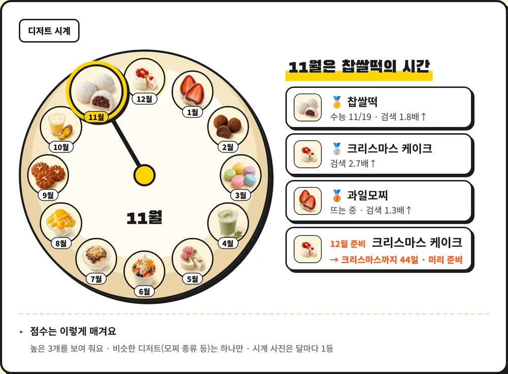
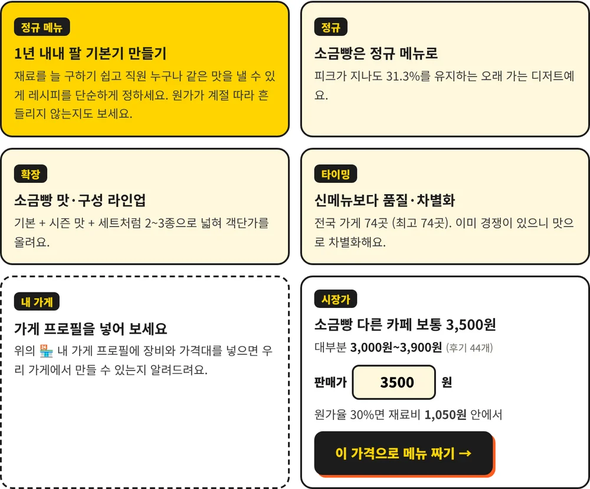

# 디저트 타이밍
### 신메뉴, 언제 내고 언제 접을까? 데이터로 답하는 F&B 기획 도구

> 새로 뜨는 디저트, 지금 출시해도 늦지 않을까?
> 우리 동네엔 이미 비슷한 가게가 많지 않을까?
> 레시피와 원가는? 얼마에 팔아야 남을까?

카페 사장님이 신메뉴 앞에서 늘 하는 세 가지 고민을 **공공데이터·농산물 시세·네이버 검색 데이터·AI**로 답하는 도구입니다.
10년치 검색량과 전국 인허가 72만 건을 분석한 결과를 바탕으로, 사장님이 **판단 → 확인 → 실행**까지 한 화면에서 할 수 있게 만들었습니다.

**👉 사이트: [hyeran712.github.io/dessert-lifecycle](https://hyeran712.github.io/dessert-lifecycle/)** · 사용법: [guide.html](https://hyeran712.github.io/dessert-lifecycle/guide.html) · 분석 노트북: [dessert_lifecycle.ipynb](dessert_lifecycle.ipynb)

---

## 세 단계로 쓰는 도구

| 단계 | 하는 일 | 화면 |
|---|---|---|
| **1 판단** | 디저트를 고르면 5가지 유행 단계(진행중·시즌형·유행형·정착형·관망형)로 진단하고 **언제·어떻게·주의** 세 줄 결론을 보여 줍니다. 이 디저트로 많이 찾는 가게 TOP 5도 함께 보여 줘요. **디저트 시계**는 달마다 검색 증가·대목·재료값·가게 수 등 8가지 점수로 '이번 달 팔기 좋은 TOP 3'를 고릅니다. |  |
| **2 확인** | **이번 주 레이더**: 매주 월요일 전국 인허가 데이터를 자동으로 받아 디저트 10종 매장 수·개업·폐업을 지도에 그립니다. **우리 동네 리포트**: 시군구 255곳마다 가게 수·생존율·비어 있는 디저트를 한 장으로 정리하고 A4 PDF로 저장할 수 있어요. |  |
| **3 실행** | **AI 신메뉴**: 메뉴 목적·가게 장비·가격대를 넣으면 AI(Gemini API)가 메뉴와 레시피를 만들고, 재료마다 실제 단가를 붙여 **원가율을 계산**합니다. 목표 원가율(30%)을 넘으면 AI가 양과 재료를 바꿔 최대 3번 다시 맞춰요. 다른 카페 판매가와 원가 기준 최소가도 나란히 보여 줍니다. |  |


## 믿을 수 있는 데이터

| 데이터 | 출처 | 쓰는 곳 |
|---|---|---|
| 전국 휴게음식점·제과점 인허가 **72만 건** | 행정안전부 지방행정 인허가 (공공데이터포털 API) | 매장 수·폐업률·주간 레이더·동네 리포트 |
| 농산물 도·소매 시세 | **한국농수산식품유통공사(aT) KAMIS** Open API | 재료 원가 계산, 한 달 새 오른 재료 경고 |
| 주간 검색량 (2016.01~2026.10) | 네이버 데이터랩 검색어 트렌드 | 유행 단계 진단·디저트 시계 |
| 월간 검색 수·연관 키워드 | **네이버 검색광고 API** | 가게당 검색 수·많이 찾는 가게(브랜드) |
| 블로그 후기·지역 검색 | 네이버 검색 API | 다른 카페 판매가(후기 500개에서 가격 추출)·브랜드 확인 |
| 설·추석 날짜 | 한국천문연구원 특일 정보 (공공데이터) | 대목 달력 자동 계산 |
| 카페 원가표 (재료 단가) | **직접 만든 구글 시트** | 신메뉴 원가율 검증의 기준 단가 |

### 직접 만든 원가표 시트
카페 운영을 가정해 **원가·레시피·재고·발주·AI 재고 조언**까지 담은 구글 시트를 직접 설계했습니다. 이 시트의 [재료단가] 탭이 신메뉴 원가 계산의 기준이 됩니다.
- 사이트에 시트 주소만 넣으면 자동으로 읽어 반영하고, 시트를 고치면 다음 계산부터 바로 바뀝니다.
- 엑셀 파일 올리기·직접 입력도 되고, 예시 시트 **사본 만들기**를 제공합니다.
- 재료 단가는 믿을 수 있는 순서로 씁니다: **내 원가표 → KAMIS 시세 → 원가표 기본 단가 → (없을 때만) AI 추정**. 결과 표에 단가마다 출처 꼬리표가 붙어요.

---

## 핵심 발견

### ① 급하게 뜬 디저트는 급하게 진다


| 구분 | 키워드 수 | 반감기 (중앙값) | 현재 수준 (피크 대비) |
|---|---|---|---|
| 20주 안에 피크 도달 | 9개 | **10주** | 7% |
| 40주 이상 걸려 피크 도달 | 6개 | **48주** | 33% |

흑당, 탕후루, 두바이 초콜릿, 달고나는 몇 달 만에 피크를 찍고 그만큼 빨리 사라졌습니다.
소금빵, 베이글, 흑임자는 몇 년에 걸쳐 천천히 오르고, 피크가 지나도 검색량의 3분의 1 이상을 유지합니다.


상승 기간과 현재 수준의 순위 상관계수는 **0.68**입니다. 천천히 뜬 디저트일수록 오래 남았습니다.

### ② 시즌형 디저트는 출시 달이 정해져 있다


쑥은 4월, 딸기모찌는 12\~2월, 찹쌀떡은 11월(수능 시즌)에 검색이 몰립니다.
이런 메뉴는 **피크 1\~2개월 전에 출시 일정을 고정**하는 것이 유리합니다.

### ③ 검색 피크를 보고 따라가면 늦다 (매장 데이터 검증)


검색량은 관심도일 뿐이라, 행정안전부 인허가 데이터로 **실제 가게가 언제 생기고 닫았는지** 확인했습니다. 상호에 키워드가 들어간 가게만 셌고, 90일 안에 닫은 곳은 팝업 매장으로 분리했습니다.

**왜 이 7종인가**: 인허가 데이터에는 메뉴 정보 없이 가게 이름만 있어, 이름으로 전문점을 가려낼 수 있는 디저트만 셀 수 있습니다. 그래서 21종 중 전문점 이름에 쓰이는 7종(탕후루·흑당·크로플·마카롱·요거트 아이스크림·베이글·모찌)을 골랐고, 유행형·관망형·정착형·진행중이 골고루 들어가도록 했습니다. 두바이 초콜릿·약과·흑임자처럼 일반 카페에서 메뉴로 파는 디저트는 2025년 이후 개업한 가게 이름에도 거의 나오지 않아(지금 영업 중 0~4곳) 제외했습니다. 이후 2026.11에 같은 기준으로 소금빵을 더하고, 주간 레이더에는 검색량 분석이 없는 붕어빵(잉어빵 포함)·땅콩빵도 매장 수만 넣었습니다.

| 디저트 | 검색 피크 | 매장 수 최고점 | 최고 → 현재 | 1년 내 폐업 (피크 전 / 후 개업) | 팝업 비율 |
|---|---|---|---|---|---|
| 탕후루 | 2023.08 | 2024.01 | 1,123 → 139곳 | 10.8% / **28.6%** | 7% |
| 크로플 | 2020.09 | 2023.02 | 312 → 76곳 | 0% / 20.7% | 25% |
| 마카롱 | 2018.05 | 2020.07 | 519 → 144곳 | 6.4% / 8.8% | 19% |
| 베이글 | 2023.03 | 2026.08 | 366 → 365곳 | 12.6% / 11.9% | 26% |
| 모찌 | 2026.10 | 진행 중 | 152곳 | – | **57%** |
| 소금빵 | 2022.07 | 2026.10 | 72 → 73곳 | – / 8.6% | 14% |

- 탕후루는 검색 피크 이후 개업한 가게의 1년 내 폐업률이 피크 전 개업보다 **약 2.6배** 높았습니다.
- 크로플·마카롱은 검색이 꺼지고 2년쯤 지나서야 매장 수가 최고점에 도달했습니다. 늦게 들어온 공급이 많았다는 뜻입니다.
- 베이글은 검색 피크 이후에도 매장이 계속 늘어, 매장 데이터에서도 정착형으로 나타났습니다.
- 소금빵은 검색 피크(2022.07)로부터 4년이 지난 지금도 전문점이 늘고 있고(지금 영업 중 73곳, 87%가 영업 중), 늦게 연 가게도 1년 안에 닫은 곳이 8.6%로 낮아 정착형으로 나타났습니다. (2026.11 추가, 피크 전 개업은 5곳이라 폐업률 계산에서 제외)
- 모찌는 인허가의 절반 이상이 백화점·쇼핑몰 팝업으로, 아직 브랜드들이 반응을 시험하는 단계입니다.

### ④ 지금 뜨는 디저트: 과일모찌


과일모찌는 2026년 10월 현재 **역대 최고 검색량**을 기록 중이며, 최근 13주 검색량이 전년 같은 시기보다 **+187%** 늘었습니다.

| 피크 대비 검색량 | 유행형 (중앙값) | 정착형 (중앙값) | 과일모찌 |
|---|---|---|---|
| 피크 52주 전 | 1% | 48% | 27% |
| 피크 13주 전 | 16% | 70% | 38% |

과일모찌는 바닥에서 갑자기 튀어 오른 유행형과 달리 **2025년부터 이미 기반이 있었고**, 2026년 7월부터 급가속했습니다.
같은 기간 찹쌀모찌(+87%)와 찹쌀떡(+23%)도 함께 올라, 단일 상품보다는 **'쫀득한 떡 디저트' 카테고리 전체의 흐름**일 가능성이 높습니다.

---

## 기획 제안

| 신호 | 판단 | 전략 |
|---|---|---|
| 몇 주 만에 급상승 | 유행형 가능성 | 기간 한정 메뉴로 빠르게 출시하고 빠르게 정리 |
| 1년 이상 꾸준히 상승 | 정착형 가능성 | 정규 메뉴 편입, 라인업 확장 |
| 매년 같은 달에 상승 | 시즌형 | 피크 1\~2개월 전으로 출시 일정 고정 |
| 검색 피크가 이미 지남 | 후발 주의 | 신규 매장·단독 메뉴 진입 자제 |

**과일모찌 적용 예시**
- 과일모찌 단품: 급상승 구간이고 경쟁 매장도 아직 팝업 단계라 **겨울 시즌 한정 메뉴로 즉시 출시**
- 찹쌀모찌·찹쌀떡 계열: 꾸준한 상승세이므로 **'쫀득 떡 디저트' 정규 라인 후보로 검토**
- 딸기모찌의 12\~2월 피크와 결합한 **겨울 딸기 과일모찌**로 두 흐름을 함께 공략

---

## 주간 디저트 레이더 (자동 업데이트)

매주 월요일 아침 GitHub Actions가 행정안전부 인허가 API에서 **지난주 이후 바뀐 가게**를 받아와 두 가지를 다시 계산합니다.

1. **디저트별 영업 중 매장 수**: 탕후루·크로플·모찌·소금빵·붕어빵·땅콩빵 등 10종의 현재 매장 수와 지난 7일 개업·폐업 (90일 안에 닫은 팝업은 따로 표시)
2. **새로 늘어나는 가게 이름 알림**: 최근 3개월 개업 매장 이름에서 그 전 1년보다 4배 이상 늘고, 6개 이상 시군구에서 동시에 나타난 단어

**과거 데이터로 검증 (2017~2026년, 매달 같은 규칙 적용)**

| 잡아낸 단어 | 레이더가 처음 알려 준 달 | 검색이 가장 많았던 달 | 결과 |
|---|---|---|---|
| 왕가탕후루 (브랜드) | 2022.11 | 2023.08 | 9개월 먼저 |
| 탕후루 (메뉴) | 2023.04 | 2023.08 | 4개월 먼저 |
| 요거트아이스크림의정석 (브랜드) | 2024.03 | 2024.08 | 5개월 먼저 |
| 크로플 (메뉴) | 2021.01 | 2020.09 | 4개월 늦음 |

쌀핫도그(2017), 티라미수(2020), 잉어빵(2024), 땅콩빵(2025)도 잡아냈습니다. 축제 부스·백화점 팝업·90일 안에 닫은 매장은 제외하고, 메뉴가 아닌 단어가 섞일 수 있어 예시 가게 이름을 함께 보여줍니다.

| 파일 | 역할 |
|---|---|
| `scripts/update.py` | API 호출 → 데이터 갱신 → `live/live.json` 생성 |
| `scripts/radar_core.py` | 새로 늘어나는 가게 이름 찾는 규칙 |
| `.github/workflows/weekly-radar.yml` | 매주 월요일 자동 실행 |
| `live/radar_base.csv.gz` | 2025년 이후 개업 매장 (새로 늘어나는 가게 이름 계산용) |

## 분석 방법

1. **데이터 통합**: 데이터랩은 한 번에 5개 키워드까지만 조회되고, 조회마다 최댓값을 100으로 둔 상대 비율을 줍니다. 모든 조회에 기준 키워드 '디저트'를 넣고, 각 파일의 '디저트' 값이 1회차와 같아지도록 배율을 맞춰 6개 파일을 하나의 기준으로 합쳤습니다.
2. **추세 추출**: 뉴스 한 번에 튀는 값의 영향을 줄이기 위해 13주(한 분기) 이동평균을 사용했습니다.
3. **수명주기 측정**: 상승 기간(피크의 25% → 피크), 반감기(피크 → 50% 아래), 현재 수준(최근 13주 평균 ÷ 피크), 전년 대비 증감(최근 13주 vs 작년 같은 13주)을 계산했습니다.
4. **유형 분류**: 진행중 / 시즌형 / 유행형 / 정착형 / 관망형으로 나눴습니다.

**데이터 이슈와 해결**
'모찌'는 네이버 데이터랩에서 전 기간 검색량이 0으로 집계되었습니다. 그래서 모찌떡·찹쌀모찌·과일모찌를 따로 조회해 합산한 **대체 지표(모찌류)**를 만들었습니다.

## 한계

- 검색량은 **관심도**이며 실제 매출과 같지 않습니다.
- 키워드 표기(띄어쓰기, 동의어)에 따라 결과가 달라질 수 있습니다.
- 매장 데이터는 상호에 키워드가 들어간 가게만 셀 수 있어, 일반 빵집에서 파는 베이글 등은 빠집니다.
- 표본이 21개라 규칙을 일반화하기에는 한계가 있습니다.
- 과일모찌의 '피크'는 현재 시점 기준이라, 이후 더 오를 수 있습니다. 앞으로 데이터를 다시 받아 예측이 맞았는지 검증할 예정입니다.

## 만든 방법

| 부분 | 쓴 것 |
|---|---|
| 분석 | Python (pandas, matplotlib), Jupyter Notebook |
| 화면 | HTML·CSS·JavaScript 한 페이지 (`src/` 네 파일을 `build.sh`로 합쳐 `index.html`), Chart.js, GitHub Pages |
| API 연결 | Cloudflare Worker — 네이버·KAMIS·Gemini·공공데이터 API를 대신 불러 줌 (**인증키는 Worker 비밀 변수에만**, 하루 사용 한도·익명 사용 통계) |
| 자동 갱신 | GitHub Actions — 매주 월요일 인허가 데이터·명절 날짜를 받아 다시 계산 |
| 로그인 | Supabase (구글·카카오) — 보관함·내 원가표·가게 프로필을 여러 기기에서 |

화면에 나오는 결과는 **판단을 돕는 참고 자료**입니다. 검색량과 가게 수는 실제 판매량이 아니고, AI 레시피와 원가는 예상값이라 직접 만들어 보고 확인해야 합니다. 이 안내를 결론 카드·신메뉴 결과·사용법 페이지에 함께 넣었습니다.

## 파일 구성

```
├── index.html                    사이트 (build.sh가 src/로 만듦)
├── src/                          화면 원본 (head.html·body.html·app.js·data.json)
├── guide.html · privacy.html     사용법 · 개인정보 처리방침
├── worker/                       Cloudflare Worker (실시간 검색·AI 신메뉴·원가 계산·시세)
├── scripts/                      주간 레이더·동네 리포트 계산
├── live/                         매주 자동 갱신되는 레이더·명절 데이터
├── docs/screens/                 README용 화면 캡처
├── dessert_lifecycle.ipynb       분석 노트북 (설명 · 코드 · 결과)
└── dessert_lifecycle/
    ├── fig1~fig5.png             분석 그래프
    ├── weekly_normalized.csv     6개 조회를 하나의 기준으로 합친 주간 데이터
    └── data/                     네이버 데이터랩 원본 엑셀 6개 + 키워드별 매장 인허가 데이터(shops_filtered.csv)
```
